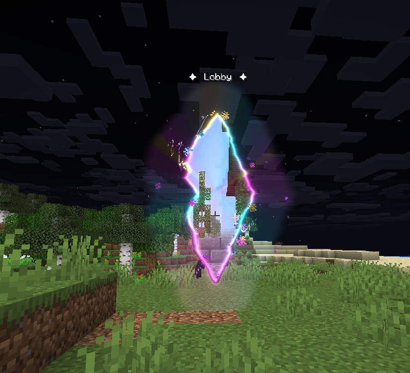

<p align="center">
  
</p>

<h1 align="center">MagicPortals</h1>

<p align="center">
  Walk-through portals between the servers of your Velocity network –<br>
  with a <b>live 3D view</b> into the destination world, rendered on the client by a resource-pack shader.
</p>

<p align="center">
  
</p>

---

## Features

- **See where you are going.** The opening shows the real destination – blocks, textures, light, water, plants, fog – in true 3D with parallax as you move. No fake blocks, no server load: a post-processing shader draws it on the client.
- **Walk through to switch servers.** Players step into the portal and Velocity moves them to the target server, where they arrive right in front of the portal leading back.
- **Two styles.** `gate` – an opening in a thick stone wall with an amethyst rim. `rift` – a floating, jagged dimensional crack with flickering cyan / magenta / gold edges, lightning arcs, sparkles, particles and a humming sound. Seen from behind, a rift shows a starry nebula.
- **Fly inside.** Spectators and replay/freecam cameras that pass through the opening end up *inside* the destination and can look around in every direction.
- **Works with your resource-pack setup.** Delivered through **Oraxen**, **ItemsAdder** or a **built-in web server** (no extra plugin needed). Ultimate UI is detected automatically.
- **Any number of servers.** Each server lists its portals in its config; up to 16 portal views per network.
- **Network-ready.** Servers share data through **MySQL / MariaDB** (multiple machines, cloud setups) or a shared folder.
- **No manual downloads.** The Minecraft client jar needed for block textures is fetched from Mojang automatically.

## Requirements

| | |
|---|---|
| Server | [Paper](https://papermc.io) **26.3** (tested with build 249) |
| Java | **25** |
| Proxy | [Velocity](https://papermc.io/software/velocity) (tested with 4.3.1), modern forwarding, `bungee-plugin-message-channel = true` (default) |
| Clients | Minecraft Java **26.3**, with the server resource pack accepted |
| Optional | Oraxen or ItemsAdder for pack delivery, MySQL/MariaDB for the exchange |

> **Shader packs:** Iris/OptiFine shader packs disable the core shaders of resource packs, so players using them see an empty portal. Turn on `fallback-blocks` if that matters to you (see [Troubleshooting](docs/troubleshooting.md)).

## Quick start

1. Download `MagicPortals-<version>.jar` from the [Releases](https://github.com/epicclowds/MagicPortals/releases), put it into the `plugins` folder of **every** server in the network and start them once.
2. On every server, open `plugins/MagicPortals/config.yml` and set
   ```yaml
   server: lobby          # this server's name from velocity.toml
   exchange:
     type: mysql          # or "folder" if all servers run on one machine
     mysql: { host: ..., database: ..., username: ..., password: ... }
   ```
3. On **one** server – the one that already handles your resource pack, usually the lobby – enable the pack:
   ```yaml
   resource-pack:
     enabled: true
     provider: auto       # Oraxen → ItemsAdder → built-in web server
   ```
4. Restart the servers and create your portals (next section).

Full walk-through: **[Installation](docs/installation.md)**.

## Setting up a portal

A portal always comes in **pairs**: lobby → survival *and* survival → lobby. Each one shows what lies in front of its counterpart.

1. **Stand where the portal should be, looking north.** The portal is built 3 blocks in front of you with its opening facing south (towards you).
2. On the lobby, run
   ```
   /mp set survival Survival
   ```
   (`survival` is the target server's name from `velocity.toml`, `Survival` the label shown above the portal.)
3. On the survival server, do the same for the way back:
   ```
   /mp set lobby Lobby
   ```
   *Tip:* if a portal has no coordinates in the config, MagicPortals places it automatically on flat ground near the world spawn.
4. Pick a look (optional):
   ```
   /mp style lobby rift
   ```
5. On the server with the resource pack, bake the views and ship the pack:
   ```
   /mp update
   ```
6. Players rejoin (or press `F3`+`T`) to load the new pack. Done – walk through!

Run `/mp update` again whenever you add, move or remove portals, or after big builds around a portal: the view through a portal is a snapshot, refreshed by every update.

## Commands

All commands need `magicportals.admin` (default: op). Aliases: `/mp`, `/magicportal`.

| Command | What it does |
|---|---|
| `/mp list` | Portals on this server: target, position, style, online state, scene number |
| `/mp set <server> [name]` | Create or move the portal to `<server>` 3 blocks north of you |
| `/mp remove <server>` | Delete the portal to `<server>` |
| `/mp style <server> <gate\|rift>` | Change the look of a portal |
| `/mp update` | Bake all portal views and deliver the resource pack (pack server only) |
| `/mp reload` | Reload `config.yml` |

## Documentation

- [Installation](docs/installation.md) – network setup from scratch, Velocity, exchange, first portal
- [Configuration](docs/configuration.md) – every option of `config.yml`
- [Resource packs](docs/resource-packs.md) – Oraxen, ItemsAdder, standalone, Ultimate UI, conflicts
- [How it works](docs/how-it-works.md) – snapshots, baking, the marker and the portal shader
- [Troubleshooting](docs/troubleshooting.md) – empty portals, kicks, shader packs and more

## Building

```bash
./gradlew build
```
The plugin jar ends up in `build/libs/`. Java 25 is required (Gradle downloads a toolchain if needed).

The `tools/` folder contains helpers for development: `ShaderCheck` compiles the portal shaders offline with shaderc (same compiler as the client), `ScenePreview` renders a baked scene on the CPU, `LogoRender` draws the logo.

## License

[MIT](LICENSE) © epicclowds. Minecraft textures used for the portal views are taken from the client jar on your own server at bake time and are not part of this repository.
