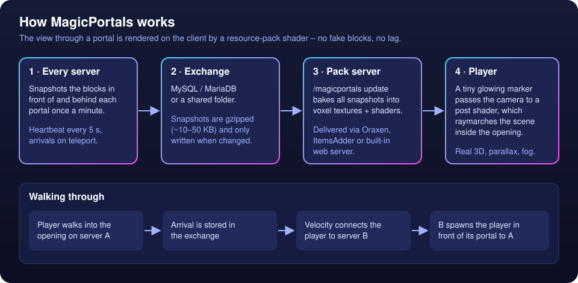

# How it works

Vanilla Minecraft cannot render a second world – the client only knows the chunks of the server it is on. MagicPortals gets around that with a resource-pack shader that draws a **baked copy** of the destination into the portal opening.

## 1. Snapshots

Every server records the surroundings of each of its portals once a minute, spread over many ticks so the server does not stutter:

- **front:** 96 × 56 × 80 blocks in front of the portal (what the other side sees through it),
- **back:** 24 rows behind the portal (used for the view when a camera flies *into* the destination).

The snapshot is rotated by 180° so it fits the viewer on the other side, serialised as a block-state palette plus indices, gzipped and written to the exchange – only when its content changed.

## 2. Baking

`/mp update` turns all snapshots into textures the GPU can read:

- **Palette:** every block state is resolved through the vanilla `blockstates/` and `models/` of the client jar into a shape (full or partial box, cross-shaped plant, fluid), six face textures, tint (grass, foliage, water) and transparency.
- **Atlas:** the 16×16 textures of all blocks used.
- **Voxels:** one texel per block: palette index plus a sky-light level computed like Minecraft's (straight down from the sky, then spreading sideways).

Up to 16 scenes share these textures; `magicportals_scene.glsl` tells the shader their size and count.

**Far terrain.** Every 5 minutes each server also records a coarse heightmap in front of its portals – surface height and top block for every 2×2 column, 256 blocks wide, 240 deep in front and 80 behind the portal (for cameras inside looking back) – from chunks that are already generated (loaded asynchronously, never generated). In worlds with a ceiling (Nether) it records the floor and the ceiling of the cave around eye height; the shader then draws the rock ceiling and a red haze instead of sky. The baker turns it into two small textures (average top-face colour, height). Rays that leave the detailed block grid continue over this heightfield; the smooth interpolation makes distant land look soft, like a depth-of-field blur.

## 3. The marker

Every portal has an invisible, tiny glowing block display at the lower left corner of its opening (seen from behind). Its glow colour encodes the scene number, the facing, the style, the options and the size of the opening.

Glowing entities are drawn a second time into Minecraft's *entity outline* buffer. MagicPortals' version of the outline vertex shader recognises the marker colour and, instead of drawing it, moves it to a 32 × 1 pixel strip at the edge of the screen. Each of these pixels stores one float bit-exactly: the projection matrix, the camera rotation, the camera position relative to the portal, scene, style and game time.

## 4. The portal shader

The entity-outline post effect runs whenever a glowing entity is on screen. MagicPortals adds a pass in front of the vanilla outline passes:

1. Read the 32 data pixels. If there is no valid marker, leave the image unchanged.
2. Rebuild the view ray of every pixel from the inverse projection and turn it into the portal's own frame (facing). The eye position is taken from the projection itself, so view bobbing and every depth convention are handled correctly.
3. Intersect the ray with the portal plane. If it hits the opening (the rectangular gate or the jagged rift outline) and the depth buffer shows nothing in front of it, continue; otherwise keep the normal image.
4. March the ray through the voxel grid (DDA) and shade the first hit: face texture, tint, face shading, sky and block light, water transparency, plants as two crossed planes. Rays that leave the grid continue over the far-terrain heightfield.
5. Rift style: add the animated edge – a thin bright line, haze, lightning arcs that flicker at their own rates, sparkles and a dark torn hem. From behind, a rift shows a starry nebula.
6. If the camera itself is inside the opening area behind the plane, the whole screen is rendered from the scene – you are "inside" the destination.
7. The portal pass writes how far away each pixel's content is into the alpha channel. A second pass (`magicportals_blur`) blurs portal pixels by that amount with a disc of samples, only gathering other portal pixels – depth of field without touching the rest of the screen.

A second small pass removes the marker pixels from the outline buffer so no glow outline appears at the screen edge.

## 5. Walking through

When a player crosses the plane inside the opening, the server stores an *arrival* (player, target, origin) in the exchange and then asks Velocity to connect the player. The target server picks the arrival up on join and teleports the player in front of the portal leading back, with a short nausea effect and a chime.

## Limits

- Minecraft **26.3** only (shader format and pack format 97).
- Portals stand upright in one of the four directions (no diagonal or floor portals).
- The view is a snapshot – refreshed by `/mp update`, not live. Mobs and players on the other side are not shown.
- The sky in the opening is a fixed gradient, not the destination's time of day.
- Max. 16 portal views per network.
- Iris/OptiFine shader packs disable the effect.
